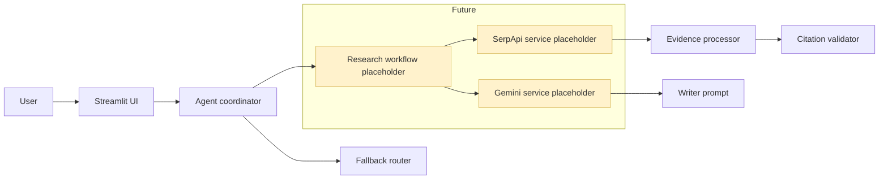

# Architecture

This project is intentionally structured as a clean scaffold for the final hackathon solution.

## Notes

- The current implementation is intentionally small and safe.
- The live Gemini and SerpApi integrations are marked as future work.
- The router is a deterministic fallback and will later be supplemented by Gemini-guided routing.
